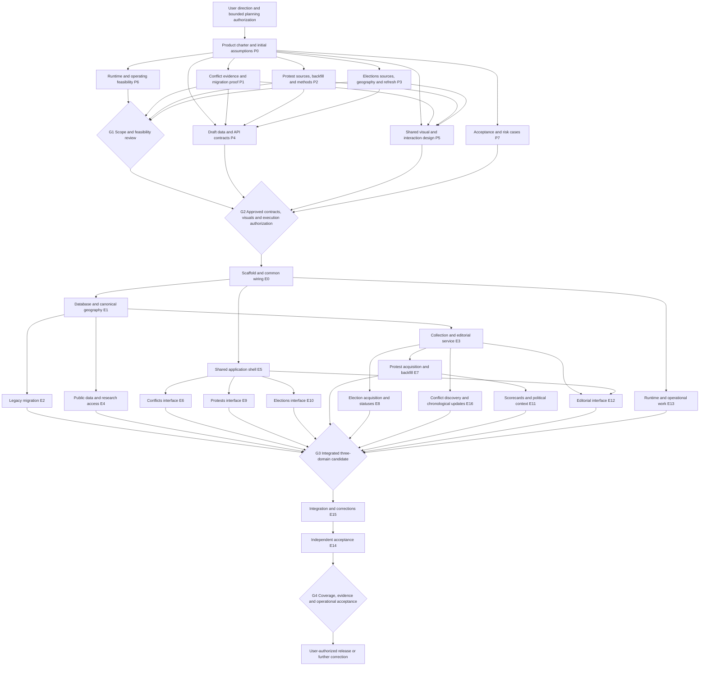

# WorldWar: departments, dependencies, and separate execution sessions

Prepared October 26, 2026. This is the requested organization and session plan for **one application covering Conflicts, Protests, and U.S. Elections**. It supplements, and does not replace, the [unified proposal](./unified-project-proposal.md) and [election addendum](./us-midterms-addendum.md). It authorizes no implementation, task creation, remote changes, service provisioning, spending, or production release. All session names and future deliverables below are proposed assignments; none has been started by this document.

**Recommendation:** organize seven departments around a shared product, run a bounded planning wave in parallel, freeze the contracts that connect those departments, then dispatch separate Sol 6.1 code sessions against those contracts. The parent chat remains the coordinator. Use Astra for consequential cross-domain decisions and synthesis, not routine implementation. Integrate in small reviewed batches and release only when data coverage, editorial operation, user journeys, and recovery are demonstrated together.

## 1. Authoritative inputs and status

| ID | Established input | Revision used here |
|---|---|---|
| R1 | `reviews/unified-project-proposal.md` | October 25 report; SHA-256 `2c3f989a8c2a68588c63696ee20edcc068a3d16ec51372d48fe803097178b770` |
| R2 | `reviews/us-midterms-addendum.md` | October 26 addendum, including the live-results appearance clarification; SHA-256 `bde01d8505f3ef71571b768864746fac646e580e41aa9756dfa50e085053e73d` |
| R3 | `review-inputs/product-concept.md` | Original complete concept and clarification; SHA-256 `997ed253f14d85bdbed96fc4367789d2e4f75945de51ec405441a323c3244e57` |
| R4 | `review-inputs/architecture-and-ui.md` | Original complete architecture/UI handoff; SHA-256 `02ba7339126585b105ee3407dabf29fb1dc4aa7827e46e6e009bc309f65c8416` |
| U | Subsequent user direction | Three domains; shared map/time/detail pattern; evolving election map may resemble live results; departmental dependency planning; separate execution sessions using `gpt-6.1-sol`; parent coordination; no execution yet |

Direct user decisions override recommendations in R1–R4. R2 adds elections to R1's two-domain language. This plan adds organization and dependencies; it does not silently approve unresolved scope or technology choices.

The repository/live-site findings remain dated **October 25**, at inspected main SHA `6dcb3feb54f9479620a29d6aa8b99193f0e882e9`, last checked 23:15:19 UTC. They include representative rendered desktop/mobile observations and interactions, not just HTTP checks. R1 preserves the evidence and limitations. This planning task did not rerun that audit or establish today's repository head. Before the first code session, the coordinator/integrator must verify the then-current base, applicable instructions, and changes since that snapshot. Ordinary workers receive that verified baseline rather than each repeating the audit.

**Readiness now:** the planning briefs below are sufficiently scoped for later dispatch, once the coordinator has authorization to create those sessions. They can investigate recommendations without pretending those recommendations are agreed. No engineering brief is execution-ready today: stack, contract, visual, source, and implementation-authorization gates remain. A polished plan is not proof that September backfill, a national results feed, or worldwide editorial coverage exists.

## 2. Department ownership

Departments are responsibility areas, not permanent agents. A person/session can occupy a role for a bounded assignment. Each artifact has one accountable owner and may have multiple reviewers.

| Department | Single accountable concern | Inputs → owned outputs | Required collaboration |
|---|---|---|---|
| Product & architecture | Product boundaries, accepted scope, architectural decisions and cross-domain tradeoffs | User decisions + R1/R2 + feasibility evidence → charter, decision register, architecture decisions, completion criteria | Resolves conflicting proposals; does not edit another owner's schema or design behind their back |
| Research & editorial | Meaning and evidentiary quality of published records | Sources + coding policy → reviewed examples, inclusion decisions, provenance, coverage ledger, corrections and publication decisions | One editorial lead owns the common standard; Conflicts, Protests, Elections desks own their factual domains |
| Data engineering | Canonical data model, identity, geography versions, schema migrations and data transformations | Reviewed examples + product requirements → data dictionary, canonical examples, migration map, reproducible imports/research views | Owns the shared contract packet; application engineering reviews API usability; editorial approves meaning |
| Design/UX | Interaction and visual system, including responsive/accessibility behavior | User journeys + representative records/states → approved screens, component/state specification, annotated flows | Tests layouts against actual data uncertainties; does not decide factual status through color choices |
| Application engineering | Working public and protected applications | Contracts + designs + reviewed fixtures → frontend/backend modules and integration candidate | One integrator owns shared wiring; frontend/backend workers own separate modules |
| Infrastructure/operations | Runtime, deployment boundary, secrets, recovery and operational visibility | Architecture + refresh/capacity requirements → hosting decision evidence, runtime configuration, runbooks, restore/rollback proof | No service purchase/provisioning without relevant authorization; editorial owns content review, not infrastructure incidents |
| Quality/validation | Independent evidence that the agreed product works | Acceptance criteria + candidate build + coverage reports → test results, defects, release recommendation | Cannot certify factual completeness from UI tests alone; editorial and operations must supply their evidence |

**Contract ownership is explicit.** Data engineering is the sole writer for canonical entity/schema definitions, publication envelopes, geographic identity rules, migration numbering and fixtures. Application engineering is the sole writer for endpoint/query/export contracts, in the same versioned contract packet, with data-engineering concurrence. Product & architecture decides disputed semantics/scope; it is not a second schema writer. Design owns visual tokens and interaction specifications until accepted; the shared-UI session then owns their implementation. Research owns source policies and coding definitions, including scorecard interpretation. Quality owns acceptance cases. The parent owns the task/decision ledger and release authorization status. These owners are roles to assign, not seven additional managers to recruit.

## 3. Dependency graph and useful parallelism

Arrows describe required outputs, not a demand to keep one worker idle until every upstream task is finished. P4 starts drafting while the three desks collect examples; it freezes only after those examples challenge the model. P5 can explore navigation, typography and mobile composition immediately, then incorporates actual long citations, uncertain locations, inherited evidence, unavailable momentum, district revisions and result states. P6 can assess runtime options while sources are tested, but cannot promise costs/cadence before their needs are known. P7 develops acceptance cases throughout.

After G2, public/domain UI sessions can build against the **approved fixtures and contract revision** while the real API is completed. That removes unnecessary backend-first serialization. Their final acceptance still requires the actual backend and data. Source acquisition and historical review can continue while UI construction proceeds. An adapter's candidate records do not become publishable merely because its engineering task passes.

The graph groups connections for readability: E11 also requires the approved method and reviewed coverage; E6 requires migrated conflict examples for final acceptance; E9 requires E7/E11; E10 requires E8; E12 requires the editorial contract. These are explicitly listed in their briefs.

### Waves and joins

1. **Planning foundation:** P0 records fixed requirements, open choices and a provisional shared direction. It should be a short coordination task using existing reports, not another broad audit. P1/P2/P3/P5/P6/P7 can then proceed in parallel, with P4 drafting and reconciling contracts. Schedule only the sessions that available capacity can actually support.
2. **G1, feasibility and scope:** compare source access/rights, multilingual and historical coverage, legacy provenance recovery, election boundary/results feasibility, operating effort and meaningful options. If a promise cannot be supported, bring the specific promise and alternatives to the user. Do not let an attractive design silently settle it.
3. **G2, build handoff:** accept charter, method specifications, contract packet, concrete desktop/mobile designs, stack/runtime decision and cost authorization boundaries. Obtain implementation authorization. The coordinator fills each code brief with exact artifact revisions and owned paths. Only then dispatch E0.
4. **Shared foundation:** after E0, E1, E5 and E13 can work in separate areas. Following E1, E2/E3/E4 are parallel subject to available slots. Following E5, the three public-domain interfaces can use fixtures. Design review can continue on detailed states without changing the contract unnoticed.
5. **Domain completion:** E7/E8/E16 consume the collection core, E11 consumes reviewed protest records/method/coverage, E12 consumes the editorial API. The desks conduct factual review and backfill alongside engineering. Integration accepts small feature batches, not one massive end-of-project dump.
6. **G3/G4, convergence:** join the real services, public views, private maintenance, reusable exports and reviewed data. E15 resolves wiring/integration; E14 independently validates. Editorial coverage acceptance and operational restore/rollback evidence are separate necessary signatures. Release is a subsequent explicitly authorized action.

**Likely critical path:** settled observation/publication scope → feasible source and review process → stable contracts → data/editorial foundation → reviewed historical content → integrated acceptance. Protest backfill and legacy source remediation may outlast code. A near-real-time nationwide election-results commitment, if chosen, creates an additional acquisition/operations critical path. It should not be assumed cheap or scheduled as a small styling task. The precise critical path and estimates become knowable only after the source exercises and selected stack; this is not a date promise.

## 4. Versioned handoff packet

The following are proposed future documents, **not files or APIs that already exist**. P0 chooses their actual location. Every accepted revision receives a version, author/owner, acceptance date and decision links. Code briefs must pin specific versions and repository base SHAs, not say “use latest.”

| ID | Future artifact | Accountable owner |
|---|---|---|
| C | Product charter, scope/decision register and release acceptance matrix | Product & architecture / parent |
| S-C, S-P, S-E | Conflict, protest and election source/coding/coverage packs | Relevant research desk |
| D | Data dictionary, IDs, temporal/geographic rules, sample records, migrations/import map | Data engineering |
| A | API/query/export and editorial-command contracts, errors and pagination | Application engineering, reviewed with data owner |
| M | Scorecard and political-context methods, limitations and test examples | Editorial lead with data reviewer |
| V | Approved desktop/mobile screens, components, flows and state annotations | Design/UX |
| O | Architecture/runtime decisions, access/rights assumptions, budget boundaries and runbooks | Architecture + operations, each owning its decisions |
| Q | Independent acceptance cases and evidence requirements | Quality |
| L | Task ledger, dependency versions, file ownership, integration revisions and blockers | Parent coordinator |

D/A must include examples for the same underlying occurrence described in three articles; one article describing multiple occurrences; date/location uncertainty; a source supporting both domains; a legacy assertion with untraceable citation; a corrected campaign assignment; a national election action with a partially enjoined provision; a district-plan revision; a pre-election results placeholder; and an official-source tally that is still provisional. Examples are synthetic and clearly marked until supported by reviewed sources. Never turn them into published facts.

A minimal shared publication envelope should identify domain/type, stable record ID, public revision, relevant place/time references, evidence references and review/freshness/coverage state. **Its actual field names and wire format remain P4 decisions.** Domain payloads retain conflict relationships, protest occurrences/campaigns, and election contests/actions/result states. A common timeline is a view over these records, not a single undifferentiated event table.

## 5. Session-wide execution rules

These rules are inherited by every engineering brief below; the coordinator must include them, plus that brief, in the separate session prompt.

- **Model and context:** `gpt-6.1-sol` for code, migration tooling, tests and integration. Leave reasoning at the user's configured default or use a task-appropriate supported level when deliberately specified; do not automatically choose max. Give the worker its brief, pinned C/D/A/V/Q/O excerpts, relevant source examples and base SHA. Full chat histories and all prior audits are unnecessary for every worker. Astra is reserved for unresolved conceptual conflicts, difficult methodology review, architecture changes and final synthesis.
- **Workspace and ownership:** isolated worktree/branch or equivalent isolated checkout per code session, created only after authorization. The brief must list concrete owned paths after stack selection. Provisional module names in this plan are not actual repository paths. A worker cannot edit another session's files, root lockfiles, shared router, contract package or migrations without an ownership transfer recorded in L. Requests to the owner are preferable to competing edits.
- **Inputs and prerequisites:** verify the pinned inputs are accessible and their versions match. Missing or contradictory contracts are blockers for dependent work; report the smallest precise question. Independent work inside the assignment can continue. Do not invent a new product policy to unblock a test.
- **Autonomy:** once the task is authorized, make routine reversible code choices, write meaningful tests, fix local failures and refactor inside the owned boundary without repeated permission requests. Escalate scope changes, breaking contracts, new data rights/access needs, uncertain factual publication, new paid dependencies, destructive migrations, production actions and significant architectural changes. A preference for another library is not by itself a reason to restart architecture selection.
- **Validation:** use Q's relevant behavior cases plus the brief's checks. Avoid tests that merely mirror implementation. Verify actual integrated behavior before claiming it works end to end. No production ingestion or publication as a test. Fixtures and test data must be visibly nonproduction and free of fabricated real-world claims.
- **Handoff:** each task supplies a short summary; pinned input versions/base SHA; branch and commit SHA(s); changed owned files; meaningful checks and results; data/rights/security implications; remaining limitations; migration/rollback notes where applicable; and exact consumer tasks now unblocked. A PR may be created only within the granted execution scope and repository workflow; include its URL and attach it to that task. Do not claim merged/deployed from a commit or PR. Do not merge or deploy without the respective authorization.
- **Definition of done:** owned deliverables completed; relevant checks pass or an explicit blocker is returned; no unresolved known defect hidden in the handoff; contracts remain conformant; no scope leakage into another worker's area. “Looks finished in my fixture view” does not satisfy downstream integration acceptance.

## 6. Planning sessions — ready as briefs, not launched

These are bounded planning/research/design assignments. They may produce local documents, permitted sample data and review visuals after dispatch authorization. They do not implement the product. Each follows the same source/version/handoff discipline as above but normally hands off files and findings, not code PRs.

### P0 — Product and architecture decision packet

**Owner/model:** Product & architecture with parent; Astra only for consequential unresolved synthesis. **Inputs:** U and exact R1–R4 above. **Prerequisites/readiness:** planning-ready; remaining product choices are explicit tasks, not silently resolved. **Objective/scope:** turn requirements into C, identify decisions that affect coverage/cost, propose the modular-monolith/SQL direction and assign owners. No repeat full audit, vendor signup or engineering scaffold. **Outputs/validation/DoD:** each requirement maps to a user journey, acceptance outcome and responsible department; proposed versus accepted decisions are distinct; source, scorecard, political context and elections obligations remain present. Hand off C draft and question list to all planning sessions; accepted C is required at G2. Routine wording/organization is autonomous; user scope, operating commitment and budget choices go to parent.

### P1 — Conflicts desk: provenance and migration proof

**Owner/model:** Conflicts research desk; Sol 6.1 for bounded evidence work. **Inputs:** C draft, R1 legacy findings, R3/R4; repository snapshot identified in R1, refreshed only if necessary for the chosen sample. **Scope:** inventory all legacy IDs/counts and citation categories, attempt recovery of the original “Global Conflict Systems” source trail from authorized materials, and produce representative actor/relationship/development mappings with evidence status. Do not rewrite assertions as verified or infer a complete timeline from git snapshots. **Examples/validation:** evidence-free “High” confidence, report-only citation, actor with different roles across conflicts, historical relationship change, ambiguous news date. Verify mappings/count reconciliation and distinguish recovered primary evidence from unavailable provenance. **DoD/handoff:** S-C plus migration/reconciliation specification, preserved legacy evidence and unresolved items; document what cannot be published as newly verified. Consumers P4/P5/E2/E6/Q. Routine research within sources is autonomous; access requests, substantive disputed assertions and proposed removals escalate.

### P2 — Protests desk: source, history and method proof

**Owner/model:** Protests desk; Sol 6.1 evidence collection; Astra only if the score/inclusion method needs unresolved cross-cutting judgment. **Inputs:** C draft, R1/R3, September 1, 2026 start requirement. **Scope:** varied regional/language/time samples; test actual historical retrieval; source permissions; occurrence deduplication; campaign membership; inclusion rationale; coverage ledger; measured review effort. Propose activity/momentum rules and factual political-context fields in M. No automatic global completeness claim, mandatory crowd cutoff, country ideology inferred from protests or combined score. **Examples/validation:** syndicated accounts, recurring marches, multi-city report, uncertain crowd, late report, source outage, changed language coverage, unmatched campaign, missing baseline. Show calculation examples and invalid/unavailable cases; prove sample dates rather than equating article retrieval with events. **DoD/handoff:** S-P and M drafts with rights, source failures, backfill route, reviewer effort, proposed action-scope options and concrete threshold decisions. Consumers P4/P5/E7/E9/E11/Q. Method and qualifying-action expansion require approval; ordinary source comparisons do not.

### P3 — Elections desk: geographic and source proof

**Owner/model:** Elections desk; Sol 6.1. **Inputs:** C draft and R2; working 2026 cycle and proposed House/Senate scope. **Scope:** sourced contest/boundary/action-status examples and coverage/refresh matrix, including official result availability/finality. Reverify selected current source facts before committing them to contracts. Compare a reviewed-update commitment with near-real-time counts if requested; no universal feed assumption. **Examples/validation:** revised district file, primary versus general/special, pre-election placeholder, provisional versus certified tally, provider call, nationwide action, allegation versus judicial finding, partial injunction. Verify source/document dates and scope, not alleged misconduct. **DoD/handoff:** S-E, specific race/refresh/history choices and acquisition/rights gaps; sufficient examples for common UI and new geography/status fields. Consumers P4/P5/E8/E10/Q. No exhaustive fifty-state platform research unless scope requires it; no fees or registrations. Escalate live-feed costs and unprovable factual status.

### P4 — Data and application contracts

**Owner/model:** Data engineering owns D; designated application contract owner owns A. Use Sol 6.1 to formalize settled decisions; Astra reviews unresolved shared semantics. **Inputs:** C draft, R1/R2 and incoming S-C/S-P/S-E/M. **Prerequisites/readiness:** can draft now; freeze blocked on source examples and G1 decisions. **Scope:** relational boundaries, identity/geometry versions, dates, evidence/revisions, publication/access rules, import mappings, queries/exports, editorial commands, error states and fixtures. No database creation or runtime code. **Validation:** every required journey and difficult example is expressible without coercing one domain into another; one idempotency/merge/correction story; private fields excluded from public contract; schema supports independently reusable queries. **DoD/handoff:** D/A version candidates, compatibility/change policy, concrete example records and endpoint/query behavior, ownership map. Consumers all engineering sessions. Field names and internal normalization are owned decisions; changed product meaning or access promises go to parent/product owner.

### P5 — Shared experience and concrete visual review

**Owner/model:** Design/UX; Sol 6.1 for bounded design production, Astra only for high-value critique. **Inputs:** C draft, R1/R2 live observations, source examples and draft D/A. **Scope:** concrete desktop/mobile screens for shared shell, each domain map/list/time view, evidence/detail reading, scorecard/context, editorial queue and error/coverage states. Use design artifacts/static review visuals; product code is not authorized. Election map may look like a results map; explicit legend/status/freshness must explain its meaning. **Validation:** walk discover→select→investigate→return; keyboard/focus plan, readable evidence, phone layout without stacked map-obscuring panels, color-independent states, accessible textual alternatives. **DoD/handoff:** V with visible designs and annotations accepted by user before UI implementation. Consumers E5/E6/E9/E10/E12/Q. Layout exploration is autonomous; dropping fields/workflows, new scoring meanings or unapproved scope goes to parent.

### P6 — Runtime, source operations and cost decision

**Owner/model:** Infrastructure/operations; Sol 6.1. **Inputs:** C, draft D/A, source access/cadence needs; R1/R2 are dated research leads. **Scope:** short primary-document comparison of viable app/database/worker hosting and mapping requirements; recommend one conventional stack/host arrangement with recurring-cost drivers, access/backup/export limits, editorial availability and incident ownership. No registration, purchase, API keys, provisioning or production changes. **Validation:** chosen arrangement supports jobs outside web requests, private/public separation, backups/restores, deployment rollback and explicit public output; map approach handles required relations and district geometry. Identify uncertainty instead of quoting invented total cost. **DoD/handoff:** O with selected/recommended distinctions and user decisions; if required feasibility prototypes would be code, request a later bounded authorization. Consumers P4/E0/E13/parent. Routine technical choices can be recommended; operating budget and external commitments require user agreement.

### P7 — Independent acceptance design

**Owner/model:** Quality; Sol 6.1. **Inputs:** C, R1/R2 deficiencies, draft D/A/V/M and source packs. **Scope:** Q acceptance matrix around user outcomes, publication integrity, rights/access, migrations, coverage, time semantics, source failures, corrections and recovery. No brittle test suite against a nonexistent implementation. **Validation/DoD:** clear pass/fail evidence for each agreed initial-release requirement; distinguish engineering tests from factual/editorial approval; identify incomplete global history, inaccessible evidence and misleading zero/result states as defects. Hand off Q and release-evidence template. Consumers every engineering session and G4. Test organization is autonomous; reduced acceptance requirements need product approval.

## 7. Engineering sessions — all blocked pending G2 and authorization

The names below are separate task assignments, not permanently running departments. Each inherits §5. Exact owned file paths and accepted version numbers must be inserted at dispatch; italicized module descriptions are provisional ownership boundaries. A session may be split into smaller successive tasks if the selected implementation makes its scope too large, preserving one writer per boundary.

### E0 — Repository foundation and integration skeleton

**Inputs/prerequisites:** accepted C/D/A/V/O/Q; freshly verified base and applicable repo instructions; execution authorization. **Owner/scope:** integrator, *root configuration, tooling, dependency manifests, module directories, CI skeleton and shared wiring*. Implement the selected typed application/service/worker layout and test/build commands; preserve legacy source as required. No domain implementation, content refresh, hosting purchase or production cutover. Define module registration points so feature workers do not edit the same router/barrel files. **Validation/DoD:** clean checkout install/build/check succeeds with documented supported runtime; public build excludes private/backend material; reproducible fixture setup and module ownership map. **Handoff:** foundation commit/base for all workers plus actual paths and commands. Consumers E1/E5/E13 and later feature sessions. Library/tooling details within O are autonomous; replacement stack or deployment target escalates.

### E1 — Canonical database, geography and migrations

**Inputs/prerequisites:** E0, pinned D/A/O/Q. **Owner/scope:** data engineering, *schema, migration registry, canonical types/fixtures and research views*. Implement accepted shared and domain tables/constraints, versioned geography and revisions; create test fixtures and migration procedure. No source adapters or public UI. Sole author of migrations, including later requested additions. **Examples/checks:** referential integrity; actor identity distinctions; uncertain date/location; geometry applicability; concurrent corrections; publication eligibility; forward migration and supported rollback/recovery on disposable databases. **DoD:** schema matches D, fixtures load, research queries work and migration checks are reproducible. Hand off commit, schema version and data-access boundaries to E2/E3/E4/E7/E8/E11. May choose indexes/constraint implementation within contract; semantic/schema-contract changes require owner review and coordinated new revision.

### E2 — Legacy conflict migration and reconciliation

**Inputs/prerequisites:** E1, S-C, D import mapping and an explicitly pinned legacy source revision. **Owner/scope:** data engineering delegate, *legacy importer, mapping manifest, reconciliation report and migration-specific tests*; request schema changes from E1 owner. Preserve actor/relationship IDs or redirects, dates, category history, article identity and original citation text. Import legacy confidence as inherited metadata; do not manufacture provenance. **Checks:** 82 actors/75 relationships applies only to the audited snapshot—reconcile the actual selected snapshot; account for every record and reject/quarantine deliberately; rerun idempotency, source hashes, date meanings, linked evidence and rollback on test DB. **DoD/handoff:** reproducible import, complete reconciliation and list of unresolved factual/source items; editorial sign-off remains separate. Consumers E6/E4/research/G3. Mapping mechanics autonomous; dropping content or upgrading evidence status escalates.

### E3 — Collection core and editorial service

**Inputs/prerequisites:** E1, A/D, source-pack common requirements, Q/O. **Owner/scope:** backend owner, *job/retrieval core, candidate store integration, editorial command service and private API*. Implement durable retrieval metadata, idempotent jobs, retry/failure reporting, review/publish/correct/retract, merge/split provenance and authentication/authorization per O. No source-specific connectors, public endpoints or editorial UI. **Examples/checks:** retry after partial failure; duplicate candidate; one source supporting multiple facts; correction after publication; unauthorized write; draft/private-note leakage; failed source does not mean zero events. **DoD/handoff:** contract tests and state transitions pass, failure/review history inspectable, fixture commands documented. Consumers E7/E8/E12 and ops. Backend organization autonomous; new publication authority or auto-publication behavior escalates.

### E4 — Published queries, search and reusable research access

**Inputs/prerequisites:** E1, A/D/C access decision, Q; E2/data fixtures for final verification. **Owner/scope:** backend public-query owner, *read service, search, filtering, pagination and approved research/export endpoints/views*. Serve published revisions and clear coverage/freshness, preserve stable IDs/routes and deterministic exports. No private editorial commands or source ingestion. **Examples/checks:** ambiguous actor names; date-range precision; missing geometry; merge redirects; consistent paginated/export snapshot; source rights filtering; direct access to draft IDs denied. **DoD/handoff:** real database queries satisfy A and accepted research-access promise; export rows reconcile to published data and document joins/time semantics. Consumers E5/E6/E9/E10/E11 and Q. Query optimization autonomous; public access expansion, schema changes or a warehouse requires escalation.

### E5 — Shared frontend and design system

**Inputs/prerequisites:** E0, accepted V and A/D fixtures, Q. **Owner/scope:** frontend foundation owner, *shared components, navigation, responsive layout, map/list/time coordination utilities, accessible reading/evidence states and route primitives*. Implement approved visuals and shared behaviors; domain semantics belong to domain modules. Do not hard-code fixture stories as real content. **Checks:** keyboard/focus, zoom, phone navigation, retained filters/back navigation, loading/error/stale/no-match/unassessed states, long source text, color-independent alternatives. **DoD/handoff:** shared components visibly match V and run against fixture contract; documented props/state interfaces and visual evidence. Consumers E6/E9/E10/E12. Internal component choices autonomous; visual redesign or missing acceptance behavior returns to design owner. Shared registration/wiring changes go through integrator.

### E6 — Conflicts public experience

**Inputs/prerequisites:** E5 and pinned conflict A/V fixtures; E2/E4 for real-data acceptance. **Owner/scope:** frontend domain owner, *Conflicts routes/components only*. Implement actor/conflict/relationship exploration, network geography, timeline, evidence and stable details; preserve useful existing relationships while clarifying legacy provenance/freshness. No schema/migration/shared-component writes. **Checks:** actor→relationship→conflict journey; direct relationship URL; role changes over time; legacy no-source label; uncertain development date; phone textual alternative; real migration IDs resolve. **DoD/handoff:** complete conflict journey on actual backend, visual comparisons and linked test evidence. Consumers G3/E14. Presentation mechanics autonomous; inventing causal relations or treating inherited confidence as verified escalates to editorial.

### E7 — Protest acquisition and September backfill tooling

**Inputs/prerequisites:** E3, S-P approved sources/permissions and inclusion policy, D/A/Q; access actually available. **Owner/scope:** data engineer, *protest source adapters, reconciliation helpers, backfill/checkpoint tooling and coverage reports*. Implement permitted retrieval and candidate normalization; preserve source dates, candidate uncertainty and dedup evidence; support reviewed inclusion/campaign decisions. No blind publishing, score formula or frontend. **Checks:** overlapping date windows, saturation, inaccessible source, syndication, late arrival, uncertain location, one report/multiple occurrences, resumable September 1 onward backfill and replay idempotency. **DoD/handoff:** source adapters demonstrated on permitted samples, reproducible backfill process, coverage/failure accounting and review queue. Full backfill is a separate factual completion condition, not satisfied by the script. Consumers research/E11/E9/G4. Extraction mechanics autonomous; unsupported regions/time claims, new paid source or changed inclusion policy escalates.

### E8 — Election acquisition, boundary and status adapters

**Inputs/prerequisites:** E3, accepted S-E race/refresh scope, D/A/Q, verified source access. **Owner/scope:** data engineer, *election connectors, contest/geometry mappings, result/status normalization and update reports*. Implement approved scope with explicit boundary plan applicability and source snapshots; retain document/action/proceeding statuses. No forecasting, voter/contact data, assumed national real-time service or adjudication of intent. **Checks:** placeholder zeros; primary/general/special identities; revised boundaries; source versus certification status; partial injunction; corrected/downward tally; county versus statewide aggregation; unavailable call/source. **DoD/handoff:** reviewed source examples reproduce accurately, unmapped/unsupported areas are explicit, refresh/failure behavior meets selected commitment. Consumers E10/editorial/G4. Parsing and caching autonomous; disputed operative boundary, live-feed commitments and substantive claim status escalate.

### E9 — Protests public experience

**Inputs/prerequisites:** E5, approved V/A/D/M fixtures; E4/E7/E11 and reviewed records for completion. **Owner/scope:** frontend domain owner, *Protests routes/components*. Implement map/list/time from September 1 onward, occurrence/campaign details, inclusion rationale/evidence, supported connections, scorecards and separate political context. No calculation invention or unverified campaign merging. **Checks:** zero observed versus unassessed; unavailable momentum; late correction; nationwide report without invented city points; calendar/range filtering; overlapping campaigns; stable route/export relation; phone evidence reading. **DoD/handoff:** reviewed real-data journey, calculations explained via backend evidence, coverage visible beside results. Consumers G3/E14. UI mechanics autonomous; interpreting timing as coordination or omitting context/scorecards is not.

### E10 — Elections public experience

**Inputs/prerequisites:** E5, accepted V/A/D/S-E fixtures; E4/E8 for completion. **Owner/scope:** frontend domain owner, *U.S. Elections routes/components*. Implement evolving map, contest/status/result detail, chronological developments and focused action/proceeding evidence using shared patterns. Results-map appearance is allowed. Each layer must label meaning, source, finality and freshness. No partisan score or inferred misconduct. **Checks:** state/Senate and district/House behavior within chosen scope; no contest versus no data; pre-election/unofficial/certified/projected states; action geography versus alleged effect; boundary vintage; partial order and stale review. **DoD/handoff:** complete sourced journeys and visual checks on actual service, with unavailable coverage honest. Consumers G3/E14. Visual mechanics autonomous; race expansion, new result semantics and factual accusations escalate.

### E11 — Scorecards and dated political context

**Inputs/prerequisites:** accepted M, D/A, E1/E4 and reviewed E7 inputs/coverage; relevant S-C/S-P political-context evidence. **Owner/scope:** data/method implementation owner, *deterministic calculation module, versioned output records and context projections*. Implement approved observed-activity and momentum definitions, reproducible input revision/window and coverage eligibility; supply dated, separately interpretable government/institution/movement context. No LLM scoring, arbitrary 0–100 composite, inferred national ideology or combined domain index. **Checks:** duplicate removal, source outage, changing coverage, late historical correction, insufficient comparison baseline, calculation replay and method-version changes. **DoD/handoff:** independently checked worked examples agree with M; unsupported momentum returns its specified unavailable state; components and provenance accessible to E9/E4/Q. Arithmetic/implementation choices autonomous; weights, thresholds, interpretation and wider political-affinity method require explicit method approval.

### E12 — Protected editorial workspace

**Inputs/prerequisites:** E3/E5, approved editorial V/A/D/Q and editor-role decision. **Owner/scope:** frontend editorial owner, *private review routes/components*. Implement candidates, evidence attachment, inclusion decisions, corrections, merge/split, publication/retraction and job/coverage inspection. Domain forms use accepted definitions; no independent rule engine. **Checks:** duplicate merge undo/correction path as specified; partially supported claim; stale source; failed job; concurrent edit; restricted role; private evidence accidentally entering public preview; publication preview matches published representation. **DoD/handoff:** editor can maintain each domain end to end through the actual service, with traceable revisions and accessible controls. Consumers research/G3/E14. Workflow details within V autonomous; auto-approval or changed permissions escalates.

### E13 — Runtime, delivery and operational verification

**Inputs/prerequisites:** E0/O, then actual E1/E3/E4 components; explicit environment/access authorization for any provisioning. **Owner/scope:** operations, *deployment configuration, CI delivery, secret references, job health, backup/restore and rollback runbooks*. Initial local/config work can run alongside E1/E5. Do not buy/register services, create production resources or cut over because the brief exists. **Checks:** deliberate public build output; secrets/drafts absent; failed/partial/stale job visible; test backup restored; application/schema rollback strategy rehearsed in an authorized nonproduction environment; documented owner/escalation path. **DoD/handoff:** operational evidence against O, costs/limits explicit and environment state accurately reported. Consumers integration/G4. Routine authorized configuration autonomous; spend, external access and production transitions require parent/user scope.

### E14 — Independent integrated acceptance

**Inputs/prerequisites:** G3 candidate integrated by E15; exact candidate SHA, Q and accepted C/D/A/V/M/O; editorial coverage reports. **Owner/scope:** Quality, *independent acceptance tests/reports and owned test fixtures*. Test actual desktop/mobile public and editorial journeys, accessibility concerns, data leakage, search/exports, corrections, history, source/result states, and operational proof. No silent scope reduction or broad implementation edits. **Examples/checks:** revisit R1's mobile/evidence/date defects; verify all three domains and real backend; distinguish no observation from missing coverage; reproduce a corrected score; trace an election status to its source. **DoD/handoff:** pass/fail matrix with evidence, remaining risks and precise defects routed to owners. Engineering pass is not global factual certification. Consumers G4/parent. Test techniques autonomous; acceptance changes need approval.

### E15 — Integration owner and release candidate

**Inputs/prerequisites:** accepted task handoffs, ownership/dependency ledger, candidate branches and Q. **Owner/scope:** dedicated integration session, *shared wiring, integration branch and cross-module correction coordination*. Integrate compatible commits in dependency order; reconcile actual backend/UI/exports; ask original owner for feature defects. This role operates incrementally after E0 and completes at G3; its node near the end of the graph indicates the full candidate, not a prohibition on early integration. **Checks:** exact contract versions, migration sequence, clean build, representative end-to-end smoke journeys, no private artifact publication, no unresolved critical integration defect. **DoD/handoff:** candidate SHA, included commits, migration/recovery notes, coverage limitations and release-evidence bundle for E14/G4. No merge to protected production branch or deploy without authorization. Mechanical integration fixes autonomous within ownership; semantic conflicts return to contract/product owner.

### E16 — Conflict discovery and chronological updates

**Inputs/prerequisites:** E3, S-C approved source/discovery policy, D/A/Q and E2 identity mappings. **Owner/scope:** data engineer, *conflict article/source adapters and candidate development/relationship-update reconciliation*. Preserve the useful news-discovery subsystem while replacing rolling-feed-only history with durable source records and reviewed chronological developments. Source acquisition can share the approved collection core, but conflict-specific mapping belongs here. Do not infer an occurrence or changed relationship merely from an article tag, or silently refresh inherited confidence. **Checks:** malformed and provider-discovery dates; failed query/partial run; repeated syndicated reporting; article with multiple actors; proposed relationship change lacking direct evidence; old record whose source trail is still unresolved; idempotent retrieval and candidate-review linkage. **DoD/handoff:** permitted sources demonstrably produce traceable candidates for the conflict editorial workflow; article versus occurrence versus assessment-change semantics remain distinct; failures/freshness visible. Consumers E6/E12/editorial/G3. Parsing and reconciliation mechanics autonomous; consequential factual relationship updates and publication decisions remain editorial responsibilities. P1 must include representative ongoing source/update examples in S-C, not only the legacy import.

## 8. Concurrency, changes, and integration safety

**One source of truth:** L tracks task ID, department/owner, session ID/link once created, model, status, exact input versions, base SHA, owned paths, dependencies, output commit/PR/artifact links, blockers and acceptance. Suggested statuses are Proposed → Ready → Running → Review → Accepted, with Blocked and Superseded explicit. Parent updates the ledger from verified handoffs; an agent's “done” is not automatically accepted.

**Version change protocol:** a worker proposes a small change explaining affected records/endpoints and downstream tasks. The relevant owner decides whether it is compatible. A breaking or meaning-changing proposal needs product/architecture review and, when it changes user scope, user decision. The contract owner publishes a new revision with examples and migration notes. Parent marks affected tasks to rebase/revalidate, suspends only incompatible dependent work, and records the decision. Avoid changing a shared contract under running workers without notification. Minor compatible extensions still receive a version and tests.

**Workspace protocol:** each code session starts from a recorded accepted integration revision in an isolated worktree/branch or equivalent checkout. Do not have multiple sessions edit the same working directory. The integrator owns root manifests, lockfile coordination, route registration and common wiring after E0. The schema owner alone allocates migrations. Shared-library requests go to E5; feature workers keep adapters inside their owned modules until a reviewed shared change is necessary. The editor and public frontend may share components but not unaudited private data paths.

**Merge order:** foundation → schema/common contracts → independent backend/UI/operations batches → domain adapters and actual-data wiring → method outputs/editorial completion → accepted candidate. UI commits built on fixtures may integrate earlier behind development-only routing if authorized; they do not constitute a public release. Refresh/rebase after relevant upstream changes, not on an arbitrary polling cadence. Resolve conflicts once with the responsible owner; do not repeatedly regenerate the entire feature. If repository policy requires PRs, the integrator uses that review path and records checks on the actual merged/rebased head.

**Capacity:** seven departments and seventeen engineering briefs do not imply twenty-four concurrent agents. The current local subagent tree has four slots total: parent plus up to three workers. The user specifically wants separate app/code sessions for execution, so the parent should dispatch those after authorization rather than treating hidden subagents as an equivalent delivery. Separate sessions still share account/model usage and may have their own runtime limits; no unlimited capacity or independent quota is assumed. Start with a small number of independent sessions and increase only when the host supports it and review/integration can keep up. A practical initial scheduling pattern is three source desks, then data-contract/visual/operations tasks, adjusting as finished evidence unlocks work. Overlap work when inputs are adequate; do not manufacture serialization merely to preserve this illustrative order.

**Future tool handling:** before creating repository tasks, parent should resolve the actual saved project using the available project listing. The app task-creation tool supports the explicitly requested `gpt-6.1-sol`; use exact authorized model rather than relying on an inherited Astra setting. Worktree creation and task creation are separate capabilities with their own rules—verify resulting paths/task IDs and ownership, do not invent automatic file synchronization. Dispatch remains a future action requiring execution/task authorization. Use concise task briefs and relevant references; no need to replay the entire conversation in every session. Parent reviews outcomes, handles explicit user decisions and sends follow-ups only within authorized coordination.

## 9. Coherent delivery increments and acceptance

These are completion milestones of the same durable application, not disposable demos or promises to finish by a particular date.

1. **Approved design and feasible research plan:** source/rights/backfill demonstrations, method examples, concrete shared desktop/mobile visuals, accepted scope, operating responsibility and conventional architecture. This is the immediate next stage.
2. **Maintainable foundation and migrated conflict system:** SQL/research access, editorial revision path, shared application shell, preserved legacy content/IDs and visible provenance qualifications, conflict map/relationships/timeline. This validates the foundation, not completion of the whole request.
3. **Three-domain candidate with real data:** protest occurrence/campaign history beginning September 1, scorecards and factual political context; election map/timeline/actions with agreed contests and update semantics; shared search/evidence/routes/export; protected maintenance. Research backfill and source review proceed throughout, not after all code finishes.
4. **Complete agreed release:** accepted historical coverage and gaps, source/provenance remediation outcomes, actual desktop/mobile/accessibility checks, reliable jobs and correction paths, private/public access checks, restored backup and rollback proof, operating owner. Only then seek the final applicable production approval. If data feasibility requires reduced coverage, that is a visible product decision—not a hidden redefinition of “complete.”

Deeper political-affinity analysis, longer historical baselines, extra election offices, national live result calls or warehouse replication can become later scoped extensions if desired. Essential scorecards, factual political context, reusable storage, conflict modernization, promised protest backfill and the agreed election workflow cannot be removed by relabeling them “phase two.”

## 10. Decisions that actually gate work

| Decision | Recommended default for review | What it gates |
|---|---|---|
| Unified product/release promise | Accept the three-domain direction and shared experience; retain distinct domain meanings | G1/G2 scope acceptance; does not prevent preparatory source/design work |
| Protest action boundary | Include significant demonstrations, strikes, occupations and blockades with contextual inclusion rationale and institutional/corporate targets | Coding policy and published backfill; samples can compare alternatives first |
| Election race/history scope | House + Senate; 2026 cycle with necessary antecedents | Geographic/race contract and source work breadth |
| Election update commitment | Evolving sourced status/results and reviewed chronology; decide actual tally/call coverage and cadence from source proof | Adapter/operations scope; near-real-time national coverage is a separate explicit commitment |
| Research access and publication rights | Guarantee owner query/export; design public-compatible outputs but expose only permitted fields | Public API/export acceptance and source choices |
| Review/operating ownership and affordable service commitment | Named editorial and operational owner; cadence matched to demonstrated capacity | Honest coverage/freshness promise and eventual release; no invented staffing |
| Method/interpretive depth | Transparent observed activity + qualified momentum, dated factual political context; no composite or affinity model until approved method | M and E11; method weights/windows are a reviewed expert deliverable, not user homework without examples |
| Stack/host and costs | Small modular application + PostgreSQL, geographic extension if validated, managed operations where justified | E0/E13; architecture should recommend a concrete choice with evidence, user decides consequential cost/ownership |

Brand naming, exact internal component layout and routine indexing are not reasons to stop the whole project. The team should recommend them inside the agreed scope. Conversely, source rights, review capacity and nationwide live-results expectations materially change what can honestly be promised and cannot be chosen silently by a coding worker.

## 11. Exact next coordinator actions

1. Present the unified three-domain recommendation and this department/dependency model for alignment. Record accepted recommendations and any changes; distinguish planning approval from execution authorization.
2. Resolve only the immediate scope choices above that the user can answer now. Let source/method/design tasks produce evidence for choices that need examples. Record provisional defaults explicitly so parallel planning can proceed without freezing them as facts.
3. When separate planning sessions are authorized, create a bounded first wave from P0–P7 with named artifact owners. Use Sol 6.1 for bounded research/spec/design production; use Astra only for high-value disputed synthesis. Do not launch all departments permanently.
4. Bring back a compact G1/G2 packet: source/backfill/provenance proof; accepted data/API examples; score/context worked examples; concrete desktop/mobile visuals; recommended stack/host/cost boundary; acceptance matrix. Show unresolved risk, not just screenshots.
5. After user alignment and explicit implementation authorization, verify the actual repository base and instructions, populate owned paths and pinned revisions in the code briefs, and create the separate Sol 6.1 execution sessions/workspaces. Start E0, then dispatch the independent foundation branches as their prerequisites are accepted.
6. Maintain L, accept handoffs, integrate incrementally, and keep factual publication and production release distinct from code completion. Request user decisions when they change scope or external commitments; let authorized workers complete routine reversible scoped work autonomously.

No sessions, worktrees, accounts, code changes, source imports, PRs, deployments or external messages were created in preparing this plan. The only new deliverable is this requested local planning document. Earlier reports and their evidence remain intact.
